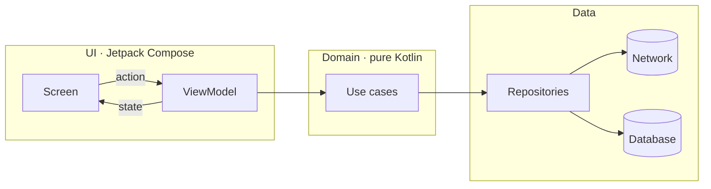

<picture>
  <source media="(prefers-color-scheme: dark)" srcset="assets/hero-dark.svg">
  <source media="(prefers-color-scheme: light)" srcset="assets/hero-light.svg">
  
</picture>

<picture>
  <source media="(prefers-color-scheme: dark)" srcset="https://readme-typing-svg.demolab.com?font=JetBrains+Mono&weight=500&size=19&duration=2600&pause=1200&color=CBA6F7&center=true&vCenter=true&width=640&height=44&lines=Readable+Kotlin+over+clever+Kotlin;One+state%2C+one+source+of+truth;Measure+first%2C+then+optimise;Ship+small%2C+ship+often">
  <source media="(prefers-color-scheme: light)" srcset="https://readme-typing-svg.demolab.com?font=JetBrains+Mono&weight=500&size=19&duration=2600&pause=1200&color=8839EF&center=true&vCenter=true&width=640&height=44&lines=Readable+Kotlin+over+clever+Kotlin;One+state%2C+one+source+of+truth;Measure+first%2C+then+optimise;Ship+small%2C+ship+often">
  
</picture>

 

## About

I'm an Android engineer with more than three years of commercial Kotlin. I work in product teams, and the job runs from a single feature to the module structure a whole app stands on: so far I have built 25 feature modules from scratch.

- 📱 **Android first.** Jetpack Compose and Material 3 on top of coroutines and Flow.
- 🧩 **Architecture.** MVI on Clean Architecture, multi-module, with one state per screen.
- 🌍 **Multiplatform.** Kotlin Multiplatform when Android and iOS should share one codebase.
- 🦀 **Below the app.** Rust behind JNI for the parts that must be fast or shared with native code.
- 🤝 **In a team.** Code review, technical interviews, Scrum.

## Stack

  <picture>
    <source media="(prefers-color-scheme: dark)" srcset="https://skillicons.dev/icons?i=kotlin,androidstudio,gradle,ktor,sqlite,firebase,rust,git,githubactions,figma&theme=dark">
    <source media="(prefers-color-scheme: light)" srcset="https://skillicons.dev/icons?i=kotlin,androidstudio,gradle,ktor,sqlite,firebase,rust,git,githubactions,figma&theme=light">
    
  </picture>

| Area | What I use |
| :-- | :-- |
| **Languages** | Kotlin, with Rust on the side |
| **UI** | Jetpack Compose, Material 3, Navigation |
| **Concurrency** | Coroutines, Flow |
| **Architecture** | MVI, Clean Architecture, multi-module, Kotlin Multiplatform |
| **Data** | Room, Retrofit, Ktor |
| **Dependency injection** | Koin |
| **Build and quality** | Gradle convention plugins, detekt, R8, GitHub Actions |

## How I build

- **One direction.** A screen sends actions and renders one immutable state.
- **Small modules.** A feature sits behind a thin API module, so builds stay fast and boundaries stay honest.
- **Build logic as code.** Convention plugins, detekt and R8 rules live next to the app and are reviewed like it.

## GitHub activity

> [!NOTE]
> Most of my Kotlin lives in private product repositories. What you see here is only the part I do in the open.

  <picture>
    <source media="(prefers-color-scheme: dark)" srcset="https://raw.githubusercontent.com/dec0iiyy/dec0iiyy/output/stats-dark.svg">
    <source media="(prefers-color-scheme: light)" srcset="https://raw.githubusercontent.com/dec0iiyy/dec0iiyy/output/stats-light.svg">
    
  </picture>
  <picture>
    <source media="(prefers-color-scheme: dark)" srcset="https://streak-stats.demolab.com/?user=dec0iiyy&mode=weekly&border_radius=14&background=1e1e2e&border=313244&stroke=313244&ring=cba6f7&fire=fab387&currStreakNum=cdd6f4&sideNums=cdd6f4&currStreakLabel=cba6f7&sideLabels=89b4fa&dates=a6adc8">
    <source media="(prefers-color-scheme: light)" srcset="https://streak-stats.demolab.com/?user=dec0iiyy&mode=weekly&border_radius=14&background=eff1f5&border=ccd0da&stroke=ccd0da&ring=8839ef&fire=fe640b&currStreakNum=4c4f69&sideNums=4c4f69&currStreakLabel=8839ef&sideLabels=1e66f5&dates=6c6f85">
    
  </picture>

  <picture>
    <source media="(prefers-color-scheme: dark)" srcset="https://raw.githubusercontent.com/dec0iiyy/dec0iiyy/output/snake-dark.svg">
    <source media="(prefers-color-scheme: light)" srcset="https://raw.githubusercontent.com/dec0iiyy/dec0iiyy/output/snake-light.svg">
    
  </picture>

<b>The last month, day by day</b>

 

  <picture>
    <source media="(prefers-color-scheme: dark)" srcset="https://github-readme-activity-graph.vercel.app/graph?username=dec0iiyy&area=true&radius=14&custom_title=Contributions%2C%20last%2031%20days&bg_color=1e1e2e&color=cdd6f4&line=cba6f7&point=89b4fa&area_color=cba6f7&border_color=313244">
    <source media="(prefers-color-scheme: light)" srcset="https://github-readme-activity-graph.vercel.app/graph?username=dec0iiyy&area=true&radius=14&custom_title=Contributions%2C%20last%2031%20days&bg_color=eff1f5&color=4c4f69&line=8839ef&point=1e66f5&area_color=8839ef&border_color=ccd0da">
    
  </picture>

<b>The last year in 3D</b>

 

  <picture>
    <source media="(prefers-color-scheme: dark)" srcset="https://raw.githubusercontent.com/dec0iiyy/dec0iiyy/output/calendar-dark.svg">
    <source media="(prefers-color-scheme: light)" srcset="https://raw.githubusercontent.com/dec0iiyy/dec0iiyy/output/calendar-light.svg">
    
  </picture>

