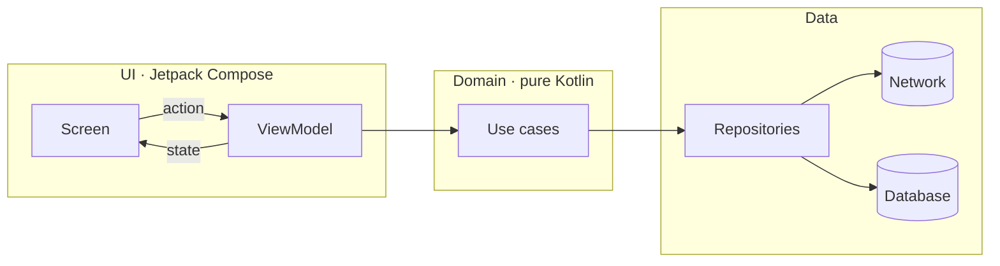
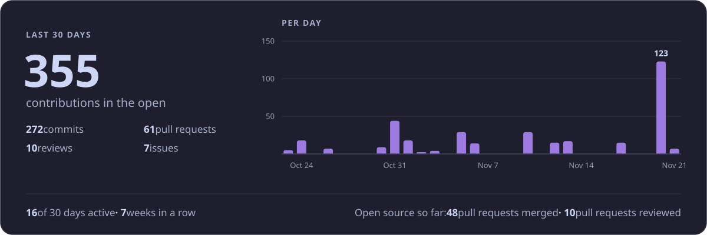

<picture>
  <source media="(prefers-color-scheme: dark)" srcset="assets/hero-dark.svg">
  <source media="(prefers-color-scheme: light)" srcset="assets/hero-light.svg">
  
</picture>

<picture>
  <source media="(prefers-color-scheme: dark)" srcset="https://readme-typing-svg.demolab.com?font=JetBrains+Mono&weight=500&size=19&duration=2600&pause=1200&color=CBA6F7&center=true&vCenter=true&width=640&height=44&lines=Readable+Kotlin+over+clever+Kotlin;From+packets+to+pixels;One+state%2C+one+source+of+truth;Measure+first%2C+then+optimise">
  <source media="(prefers-color-scheme: light)" srcset="https://readme-typing-svg.demolab.com?font=JetBrains+Mono&weight=500&size=19&duration=2600&pause=1200&color=8839EF&center=true&vCenter=true&width=640&height=44&lines=Readable+Kotlin+over+clever+Kotlin;From+packets+to+pixels;One+state%2C+one+source+of+truth;Measure+first%2C+then+optimise">
  
</picture>

 

## About

I'm an Android engineer with more than three years of commercial Kotlin. I work in product teams, and the job runs from a single feature to the module structure a whole app stands on: so far I have built 25 feature modules from scratch. In the open, I contribute to networking code in Rust.

- 📱 **Android first.** Jetpack Compose and Material 3 on top of coroutines and Flow.
- 🧩 **Architecture.** MVI on Clean Architecture, multi-module, with one state per screen.
- 🌍 **Multiplatform.** Kotlin Multiplatform when Android and iOS should share one codebase.
- 🦀 **Networking in Rust.** TLS, QUIC and DNS on async I/O, with the JNI and FFI bridges that bring one core to Android and iOS.
- 🤝 **In a team.** Code review, technical interviews, Scrum.

## Stack

  <picture>
    <source media="(prefers-color-scheme: dark)" srcset="https://skillicons.dev/icons?i=kotlin%2Candroidstudio%2Cgradle%2Cktor%2Csqlite%2Cfirebase%2Crust%2Cgit%2Cgithubactions%2Cfigma&theme=dark">
    <source media="(prefers-color-scheme: light)" srcset="https://skillicons.dev/icons?i=kotlin%2Candroidstudio%2Cgradle%2Cktor%2Csqlite%2Cfirebase%2Crust%2Cgit%2Cgithubactions%2Cfigma&theme=light">
    
  </picture>

| Area | What I use |
| :-- | :-- |
| **Languages** | Kotlin, Rust |
| **UI** | Jetpack Compose, Material 3, Navigation |
| **Concurrency** | Coroutines, Flow |
| **Architecture** | MVI, Clean Architecture, multi-module, Kotlin Multiplatform |
| **Data** | Room, Retrofit, Ktor |
| **Dependency injection** | Koin |
| **Networking** | Rust with Tokio: TLS, QUIC, DNS |
| **Build and quality** | Gradle convention plugins, detekt, R8, GitHub Actions |

## How I build

- **One direction.** A screen sends actions and renders one immutable state.
- **Small modules.** A feature sits behind a thin API module, so builds stay fast and boundaries stay honest.
- **Build logic as code.** Convention plugins, detekt and R8 rules live next to the app and are reviewed like it.

## GitHub activity

> [!NOTE]
> Most of my Kotlin lives in private product repositories. What you see here is only the part I do in the open.

  <picture>
    <source media="(prefers-color-scheme: dark)" srcset="https://raw.githubusercontent.com/dec0iiyy/dec0iiyy/output/activity-dark.svg">
    <source media="(prefers-color-scheme: light)" srcset="https://raw.githubusercontent.com/dec0iiyy/dec0iiyy/output/activity-light.svg">
    
  </picture>

